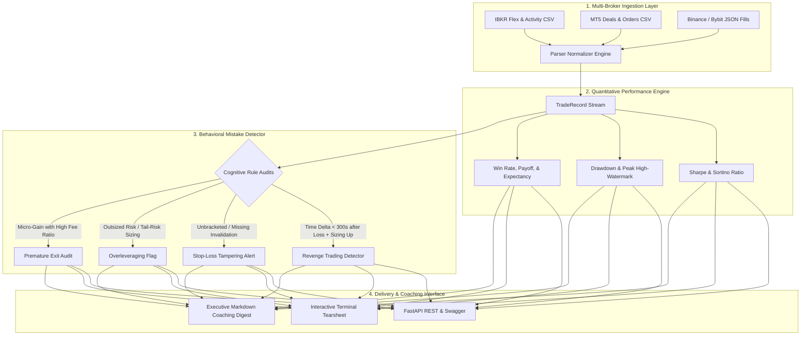

# 🧠 OpenTradeJournal-AI: Institutional Trade Journal & Cognitive Mistake Detector

[](https://python.org)
[](https://fastapi.tiangolo.com)
[](https://docker.com)
[](https://github.com)
[](https://opensource.org/licenses/MIT)

> An institutional-grade algorithmic trade journal, quantitative performance analytics engine, and behavioral psychology audit tool. Automatically ingests trade statements from **Interactive Brokers (IBKR)**, **MetaTrader 5 (MT5)**, and **Crypto Exchanges (Binance / Bybit)**, calculates risk-adjusted return tearsheets, and algorithmically identifies cognitive trading mistakes like **Revenge Trading**, **FOMO**, **Overleveraging**, and **Stop-Loss Tampering**.

---

### 💼 Need Custom Quantitative Algorithms, Prop Firm Bots, or Trading Infrastructure?
I engineer high-performance trading software, broker API bridges, low-latency execution engines, and algorithmic risk guardians for prop traders, private syndicates, and hedge funds.
* 💬 **Telegram:** [@JanzebBlockdev](https://t.me/JanzebBlockdev)
* 💼 **Fiverr Profile:** [jahanzaib313110 (Fiverr Pro Specialist)](https://www.fiverr.com/jahanzaib313110)
* 🌐 **GitHub Portfolio:** [@jahanzaib-codes](https://github.com/jahanzaib-codes)

---

## 🏛️ System Architecture



---

## ✨ Key Architectural Highlights

* **Multi-Broker Normalization:** Seamlessly imports executions from Interactive Brokers (TWS/Portal), MetaTrader 5 (HTML/CSV history), and Tier-1 Crypto exchanges into a uniform `TradeRecord` model.
* **Algorithmic Cognitive Bias Detection:** Flags toxic psychological trading impulses:
  * **Revenge Trading:** Detects rapid re-entries ($T \le 300$ seconds) after losses with equal or amplified sizing.
  * **Stop-Loss Tampering:** Identifies unprotected positions held into negative drift without structural stop losses.
  * **Overleveraging:** Audits single-trade exposure exceeding safe account risk envelope (> 2.0% equity).
  * **Premature Profit Taking:** Identifies fear-based exits that cut winners prematurely, destroying portfolio expectancy.
* **Quantitative Tearsheet Generator:** Computes annualized Sharpe ratio, Sortino ratio (downside deviation based), maximum drawdown percentage, profit factor, payoff ratio, and net expectancy.
* **Containerized Deployment:** Zero-friction orchestration with pre-configured Dockerfile and docker-compose.

---

## 🚀 Quickstart Guide

### 1. Installation
```bash
git clone https://github.com/jahanzaib-codes/OpenTradeJournal-AI.git
cd OpenTradeJournal-AI

# Create virtual environment
python -m venv venv
source venv/bin/activate  # On Windows: venv\Scripts\activate

# Install dependencies
pip install -r requirements.txt
```

### 2. Run Interactive CLI Demo
Experience the full tearsheet and psychology diagnostic audit right inside your terminal:
```bash
python cli.py demo
```

### 3. Analyze Your Own Broker Statement
```bash
# Analyze Interactive Brokers statement
python cli.py analyze --file /path/to/ibkr_statement.csv --broker ibkr

# Analyze MetaTrader 5 trade history
python cli.py analyze --file /path/to/mt5_history.csv --broker mt5

# Analyze Binance/Bybit fills
python cli.py analyze --file /path/to/binance_fills.json --broker binance
```

---

## 🖥️ Terminal Tearsheet Preview

```text
================================================================================
           🏛️ OPENTRADEJOURNAL-AI: QUANTITATIVE PERFORMANCE TEARSHEET           
================================================================================
╒═══════════════════════════════╤══════════════════════╕
│ Performance Metric            │ Quantitative Value   │
╞═══════════════════════════════╪══════════════════════╡
│ Total Executed Trades         │ 5                    │
├───────────────────────────────┼──────────────────────┤
│ Winning Trades                │ 2 (40.0%)            │
├───────────────────────────────┼──────────────────────┤
│ Losing Trades                 │ 3                    │
├───────────────────────────────┼──────────────────────┤
│ Total Net PnL                 │ $4,830.00            │
├───────────────────────────────┼──────────────────────┤
│ Profit Factor                 │ 4.80                 │
├───────────────────────────────┼──────────────────────┤
│ Payoff Ratio (Avg Win / Loss) │ 7.20                 │
├───────────────────────────────┼──────────────────────┤
│ Average Win                   │ $3,050.00            │
├───────────────────────────────┼──────────────────────┤
│ Average Loss                  │ $423.33              │
├───────────────────────────────┼──────────────────────┤
│ Expectancy per Trade          │ $966.00              │
├───────────────────────────────┼──────────────────────┤
│ Maximum Peak Drawdown         │ $750.00 (13.4%)      │
├───────────────────────────────┼──────────────────────┤
│ Annualized Sharpe Ratio       │ 7.90                 │
├───────────────────────────────┼──────────────────────┤
│ Sortino Ratio (Downside)      │ 64.94                │
├───────────────────────────────┼──────────────────────┤
│ Brokerage Commissions         │ $34.00               │
╘═══════════════════════════════╧══════════════════════╛
================================================================================
```

---

## 🌐 FastAPI REST Endpoints

Start the API server:
```bash
python main.py
# Or with Docker
docker compose up -d
```
Visit the interactive Swagger UI at **`http://localhost:8000/docs`**.

| Method | Endpoint | Description |
| :--- | :--- | :--- |
| `GET` | `/health` | Service health status and timestamp |
| `POST` | `/api/v1/import` | Ingest broker statement (IBKR CSV, MT5 CSV, Binance JSON) |
| `GET` | `/api/v1/analytics/performance` | Returns full quantitative risk-adjusted return metrics |
| `GET` | `/api/v1/analytics/psychology` | Returns cognitive mistake audit and debiasing coaching |
| `GET` | `/api/v1/reports/tearsheet` | Generates formatted ASCII tearsheet |
| `POST` | `/api/v1/demo/load` | Pre-populates journal with realistic multi-broker trades |

---

## 🛡️ License
Distributed under the **MIT License**. See [`LICENSE`](LICENSE) for complete details.
